# WealthMap Database Schema & SQL Queries Documentation

This document provides a comprehensive breakdown of the database architecture, table schemas, entity relationships, and all SQL queries executed across the **WealthMap** application.

---

## 1. Architectural Overview & Database Design

WealthMap runs on a **PostgreSQL** relational database (hosted via Supabase / PostgreSQL 14+), interfaced through **Spring Boot 3 + Spring Data JPA (Hibernate)**.

### Key Design Patterns:
1. **Joined Table Inheritance (`InheritanceType.JOINED`)**:
   - `Asset` is the abstract root entity stored in `assets`. Specialized asset subclasses (`stock`, `mutual_fund`, `fixed_deposit`, `gold_items`, `cryptocurrencies`, `esop_rsus`, `bonds`, `real_estate`) store subtype-specific columns with a primary key foreign-referencing `assets(id) ON DELETE CASCADE`.
   - `Liability` is the abstract root entity in `liabilities`. Subclasses (`home_loans`, `personal_loans`, `vehicle_loans`, `education_loans`, `credit_card_debt`, `other_liabilities`) link directly to `liabilities(id) ON DELETE CASCADE`.
2. **Multi-Tenancy & Family Group Roll-Up**:
   - Every asset, liability, and goal can be assigned to a `user_id` and optionally tagged with a `family_group_id` for role-based aggregation (Owner, Editor, Viewer).
3. **Element Collections**:
   - `user_tfa_recovery_codes` and `goal_tagged_assets` handle one-to-many scalar relationships without unnecessary entity overhead.
4. **Auditability & Automation**:
   - Background services scan `price_alerts` and `fixed_deposit` maturities to automatically emit alerts and persist records into `notification_histories` and `audit_logs`.

---

## 2. Entity-Relationship Diagram (ERD)

```mermaid
erDiagram
    users ||--o{ assets : "owns"
    users ||--o{ liabilities : "owes"
    users ||--o{ financial_goals : "creates"
    users ||--o{ net_worth_snapshots : "records"
    users ||--o{ asset_documents : "uploads"
    users ||--o{ price_alerts : "sets"
    users ||--o{ notification_histories : "receives"
    users ||--o| emergency_funds : "configures"
    users ||--o| rebalancing_targets : "configures"
    users ||--o| password_reset_tokens : "has"
    users ||--o{ user_tfa_recovery_codes : "has"
    family_groups ||--o{ users : "members"
    family_groups ||--o{ family_invites : "sends"
    family_groups ||--o{ assets : "shares"
    family_groups ||--o{ liabilities : "shares"
    family_groups ||--o{ financial_goals : "shares"

    assets ||--o| stock : "specializes"
    assets ||--o| mutual_fund : "specializes"
    assets ||--o| fixed_deposit : "specializes"
    assets ||--o| gold_items : "specializes"
    assets ||--o| cryptocurrencies : "specializes"
    assets ||--o| esop_rsus : "specializes"
    assets ||--o| bonds : "specializes"
    assets ||--o| real_estate : "specializes"
    assets ||--o{ asset_documents : "linked to"

    liabilities ||--o| home_loans : "specializes"
    liabilities ||--o| personal_loans : "specializes"
    liabilities ||--o| vehicle_loans : "specializes"
    liabilities ||--o| education_loans : "specializes"
    liabilities ||--o| credit_card_debt : "specializes"
    liabilities ||--o| other_liabilities : "specializes"
    liabilities ||--o{ asset_documents : "linked to"

    financial_goals ||--o{ goal_tagged_assets : "tags"
```



---

## 3. Data Dictionary: Tables & Schema Details

### 3.1 Authentication, Users & Family Groups

#### `users`
Stores user profile, authentication credentials, 2FA status, and Google OAuth / Drive integration tokens.
| Column | Data Type | Nullable | Description |
| :--- | :--- | :--- | :--- |
| `id` | `BIGSERIAL` | No | Primary Key |
| `name` | `VARCHAR(255)` | No | User's full name |
| `email` | `VARCHAR(255)` | No | Unique login email |
| `password` | `VARCHAR(255)` | No | BCrypt hashed password |
| `mobile_number` | `VARCHAR(50)` | Yes | Contact phone number |
| `family_group_id` | `BIGINT` | Yes | FK to `family_groups(id)` |
| `family_role` | `VARCHAR(50)` | Yes | Role in family (`OWNER`, `EDITOR`, `VIEWER`) |
| `tfa_enabled` | `BOOLEAN` | Yes | Two-factor authentication toggle |
| `tfa_secret` | `VARCHAR(255)` | Yes | TOTP secret key |
| `google_id` | `VARCHAR(255)` | Yes | Google OAuth subject ID |
| `google_email` | `VARCHAR(255)` | Yes | Google account email |
| `google_access_token` | `TEXT` | Yes | Google Drive API access token |
| `google_refresh_token` | `TEXT` | Yes | Google Drive API refresh token |
| `google_token_expires_at` | `TIMESTAMP` | Yes | Expiration timestamp for Google token |
| `google_drive_folder_id` | `VARCHAR(255)` | Yes | WealthMap vault folder ID in Drive |
| `created_at` | `TIMESTAMP` | Yes | Timestamp of account creation |

#### `family_groups`
Stores family collective groups for portfolio aggregation.
| Column | Data Type | Nullable | Description |
| :--- | :--- | :--- | :--- |
| `id` | `BIGSERIAL` | No | Primary Key |
| `name` | `VARCHAR(255)` | No | Group name (e.g. "Kulkarni Family") |
| `invite_code` | `VARCHAR(255)` | No | Unique 8-character invite code |
| `creator_id` | `BIGINT` | No | User ID of family group creator |
| `created_at` | `TIMESTAMP` | Yes | Timestamp of group creation |

#### `family_invites`
Tracks pending and accepted family invitations.
| Column | Data Type | Nullable | Description |
| :--- | :--- | :--- | :--- |
| `id` | `BIGSERIAL` | No | Primary Key |
| `family_group_id` | `BIGINT` | No | FK to `family_groups(id)` |
| `invitee_email` | `VARCHAR(255)` | No | Email of the invitee |
| `invitee_name` | `VARCHAR(255)` | No | Name of the invitee |
| `token` | `VARCHAR(255)` | No | Unique secure join token |
| `status` | `VARCHAR(50)` | No | `PENDING` or `ACCEPTED` |
| `created_at` | `TIMESTAMP` | Yes | Invite generation timestamp |

#### `user_tfa_recovery_codes`
| Column | Data Type | Nullable | Description |
| :--- | :--- | :--- | :--- |
| `user_id` | `BIGINT` | No | FK to `users(id)` |
| `recovery_code` | `VARCHAR(255)` | No | One-time backup recovery code |

#### `password_reset_tokens`
| Column | Data Type | Nullable | Description |
| :--- | :--- | :--- | :--- |
| `id` | `BIGSERIAL` | No | Primary Key |
| `user_id` | `BIGINT` | No | FK to `users(id)` |
| `otp` | `VARCHAR(50)` | No | 6-digit numeric OTP |
| `expiry_date` | `TIMESTAMP` | No | 15-minute expiration timestamp |

---

### 3.2 Polymorphic Assets Tables (`InheritanceType.JOINED`)

#### `assets` (Base Table)
| Column | Data Type | Nullable | Description |
| :--- | :--- | :--- | :--- |
| `id` | `BIGSERIAL` | No | Primary Key |
| `user_id` | `BIGINT` | No | FK to `users(id)` |
| `family_group_id` | `BIGINT` | Yes | FK to `family_groups(id)` |
| `name` | `VARCHAR(255)` | No | Name of the asset |
| `asset_type` | `VARCHAR(50)` | No | `STOCK`, `MUTUAL_FUND`, `FIXED_DEPOSIT`, `GOLD`, `CRYPTOCURRENCY`, `ESOP_RSU`, `BOND`, `REAL_ESTATE`, etc. |
| `currency` | `VARCHAR(10)` | Yes | Default: `INR` |
| `purchase_date` | `DATE` | Yes | Date of investment |
| `notes` | `TEXT` | Yes | User remarks |
| `nominee_name` | `VARCHAR(255)` | Yes | Estate planning nominee |
| `nominee_relationship` | `VARCHAR(100)` | Yes | Nominee relationship |
| `created_at` | `TIMESTAMP` | Yes | Audit creation timestamp |
| `updated_at` | `TIMESTAMP` | Yes | Audit update timestamp |

#### Subclass Tables (Each references `assets(id)` as PK and FK):
1. **`stock`**: `ticker`, `company_name`, `quantity`, `average_buy_price`
2. **`mutual_fund`**: `scheme_code` (AMFI), `scheme_name`, `folio_number`, `units`, `average_nav`
3. **`fixed_deposit`**: `bank_name`, `principal_amount`, `interest_rate`, `compounding_frequency`, `start_date`, `maturity_date`
4. **`gold_items`**: `weight_grams`, `purity` (`K18`, `K20`, `K22`, `K24`), `purchase_price`
5. **`cryptocurrencies`**: `coin_id` (e.g. `bitcoin`), `symbol` (`BTC`), `units`, `average_buy_price`
6. **`esop_rsus`**: `plan_type` (`ESOP`/`RSU`), `company_name`, `ticker`, `grant_date`, `vesting_start_date`, `total_units_granted`, `vested_units`, `unvested_units`, `strike_price`, `current_stock_price`
7. **`bonds`**: `bond_type`, `issuer`, `coupon_rate`, `invested_amount`, `face_value`, `quantity`, `compounding_frequency`, `start_date`, `maturity_date`
8. **`real_estate`**: `property_name`, `property_type`, `purchase_price`, `estimated_current_value`
9. **`gold_price_history`**: `id`, `date`, `price_per_gram_24k`, `currency`, `created_at`

---

### 3.3 Polymorphic Liabilities Tables (`InheritanceType.JOINED`)

#### `liabilities` (Base Table)
| Column | Data Type | Nullable | Description |
| :--- | :--- | :--- | :--- |
| `id` | `BIGSERIAL` | No | Primary Key |
| `user_id` | `BIGINT` | No | FK to `users(id)` |
| `family_group_id` | `BIGINT` | Yes | FK to `family_groups(id)` |
| `name` | `VARCHAR(255)` | No | Name / Label of debt |
| `liability_type` | `VARCHAR(50)` | No | `HOME_LOAN`, `PERSONAL_LOAN`, `EDUCATION_LOAN`, `CREDIT_CARD_DEBT`, `VEHICLE_LOAN`, `OTHER_LIABILITY` |
| `principal_amount` | `NUMERIC(19,2)`| Yes | Original sanctioned loan amount |
| `interest_rate` | `NUMERIC(8,4)` | Yes | Annual interest rate percentage |
| `tenure_months` | `INTEGER` | Yes | Loan tenure in months |
| `outstanding_balance`| `NUMERIC(19,2)`| Yes | Remaining unpaid principal |
| `emi` | `NUMERIC(19,2)`| Yes | Monthly installment |
| `start_date` | `DATE` | Yes | Loan disbursement date |
| `notes` | `TEXT` | Yes | Remarks |

#### Subclass Tables (Each references `liabilities(id)` as PK and FK):
1. **`home_loans`**: `lender_name`, `property_address`
2. **`personal_loans`**: `lender_name`, `purpose`
3. **`vehicle_loans`**: `lender_name`, `vehicle_model`
4. **`education_loans`**: `lender_name`, `institution_name`
5. **`credit_card_debt`**: `card_issuer`, `last_four_digits`
6. **`other_liabilities`**: `description_detail`

---

### 3.4 Planning, Documents, Analytics & Logs

| Table | Purpose | Key Columns |
| :--- | :--- | :--- |
| **`financial_goals`** | Financial milestone tracking | `id`, `user_id`, `family_group_id`, `name`, `target_amount`, `target_date`, `notes` |
| **`goal_tagged_assets`** | Many-to-many goal asset linkage | `goal_id` (FK to `financial_goals`), `asset_id` |
| **`emergency_funds`** | 6-month safety net setup | `id`, `user_id` (Unique FK), `monthly_expense`, `target_months` |
| **`rebalancing_targets`** | Target asset allocation & drift % | `id`, `user_id` (Unique FK), `target_equity_pct`, `target_debt_pct`, `target_gold_pct`, `drift_threshold_pct` |
| **`net_worth_snapshots`**| Historical tracking for trend charts | `id`, `user_id`, `snapshot_date`, `net_worth`, `total_assets`, `total_liabilities` |
| **`asset_documents`** | Google Drive integrated Document Vault | `id`, `user_id`, `asset_id`, `liability_id`, `file_name`, `file_size`, `mime_type`, `drive_file_id`, `drive_view_url`, `drive_download_url`, `document_type`, `extracted_data_json` |
| **`price_alerts`** | Automation price triggers | `id`, `user_id`, `asset_id`, `asset_name`, `asset_type`, `target_price`, `alert_condition` (`ABOVE`/`BELOW`), `active`, `last_observed_price`, `last_triggered_at` |
| **`notification_histories`**| Push / In-app alerts | `id`, `user_id`, `title`, `message`, `type`, `reference_type`, `reference_id`, `is_read` |
| **`audit_logs`** | Security and action logs | `id`, `user_email`, `user_name`, `action`, `target_type`, `target_id`, `details`, `timestamp` |

---

## 4. SQL Queries Reference Catalog

Below are all major queries generated by Spring Data JPA Repositories and custom services:

### 4.1 Authentication & Profile Queries
```sql
-- 1. Check if user exists by email (UserRepository.existsByEmail)
SELECT COUNT(*) > 0 FROM users WHERE email = :email;

-- 2. Find user by email for login & JWT authentication (UserRepository.findByEmail)
SELECT * FROM users WHERE email = :email;

-- 3. Verify OTP for password reset (PasswordResetTokenRepository.findByOtp)
SELECT * FROM password_reset_tokens WHERE otp = :otp AND expiry_date > CURRENT_TIMESTAMP;

-- 4. Invalidate old reset tokens
DELETE FROM password_reset_tokens WHERE user_id = :userId;
```

### 4.2 Polymorphic Asset Fetching & CRUD
```sql
-- 1. Fetch all assets for a user (AssetRepository.findByUserId)
-- JPA automatically generates an outer join across all subclass tables:
SELECT a.*, s.*, m.*, fd.*, g.*, c.*, e.*, b.*, r.*
FROM assets a
LEFT JOIN stock s ON a.id = s.id
LEFT JOIN mutual_fund m ON a.id = m.id
LEFT JOIN fixed_deposit fd ON a.id = fd.id
LEFT JOIN gold_items g ON a.id = g.id
LEFT JOIN cryptocurrencies c ON a.id = c.id
LEFT JOIN esop_rsus e ON a.id = e.id
LEFT JOIN bonds b ON a.id = b.id
LEFT JOIN real_estate r ON a.id = r.id
WHERE a.user_id = :userId;

-- 2. Filter assets by category (AssetRepository.findByUserIdAndAssetType)
SELECT a.*, s.* 
FROM assets a
JOIN stock s ON a.id = s.id
WHERE a.user_id = :userId AND a.asset_type = 'STOCK';

-- 3. Insert new Real Estate asset (Two-step JPA insert)
INSERT INTO assets (user_id, name, asset_type, currency, purchase_date)
VALUES (1, 'Greenwood 3BHK', 'REAL_ESTATE', 'INR', '2024-03-01')
RETURNING id; -- e.g. returns 101

INSERT INTO real_estate (id, property_name, property_type, purchase_price, estimated_current_value)
VALUES (101, 'Greenwood Heights 3BHK', 'APARTMENT', 8500000.00, 9200000.00);
```

### 4.3 Automated Maturity Reminders & Price Alert Scanning
```sql
-- 1. Scan Fixed Deposits maturing within the next 7 days
SELECT a.id, a.user_id, a.name, fd.bank_name, fd.principal_amount, fd.maturity_date, u.email, u.name AS user_name
FROM assets a
JOIN fixed_deposit fd ON a.id = fd.id
JOIN users u ON a.user_id = u.id
WHERE fd.maturity_date BETWEEN CURRENT_DATE AND (CURRENT_DATE + INTERVAL '7 days');

-- 2. Fetch all active price alerts for background price checker (PriceAlertRepository.findByActiveTrue)
SELECT pa.*, u.email, u.name 
FROM price_alerts pa
JOIN users u ON pa.user_id = u.id
WHERE pa.active = true;

-- 3. Deactivate price alert after notification triggered
UPDATE price_alerts 
SET active = false, last_observed_price = :price, last_triggered_at = CURRENT_TIMESTAMP
WHERE id = :alertId;
```

### 4.4 Family Group Aggregate & Portfolio Allocation
```sql
-- 1. Family group assets roll-up
SELECT 
    a.asset_type,
    COUNT(a.id) AS count,
    SUM(
        COALESCE(s.quantity * s.average_buy_price, 0) +
        COALESCE(m.units * m.average_nav, 0) +
        COALESCE(fd.principal_amount, 0) +
        COALESCE(g.purchase_price, 0) +
        COALESCE(c.units * c.average_buy_price, 0) +
        COALESCE(e.vested_units * e.strike_price, 0) +
        COALESCE(b.invested_amount, b.quantity * b.face_value, 0) +
        COALESCE(r.estimated_current_value, r.purchase_price, 0)
    ) AS total_value
FROM assets a
JOIN users u ON a.user_id = u.id
LEFT JOIN stock s ON a.id = s.id
LEFT JOIN mutual_fund m ON a.id = m.id
LEFT JOIN fixed_deposit fd ON a.id = fd.id
LEFT JOIN gold_items g ON a.id = g.id
LEFT JOIN cryptocurrencies c ON a.id = c.id
LEFT JOIN esop_rsus e ON a.id = e.id
LEFT JOIN bonds b ON a.id = b.id
LEFT JOIN real_estate r ON a.id = r.id
WHERE u.family_group_id = :familyGroupId
GROUP BY a.asset_type;
```

### 4.5 Historical Net Worth Snapshots
```sql
-- 1. Retrieve net worth snapshot timeline for charts (NetWorthSnapshotRepository.findByUserIdOrderBySnapshotDateAsc)
SELECT snapshot_date, net_worth, total_assets, total_liabilities
FROM net_worth_snapshots
WHERE user_id = :userId
ORDER BY snapshot_date ASC;

-- 2. Record daily / monthly automated net worth snapshot
INSERT INTO net_worth_snapshots (user_id, snapshot_date, net_worth, total_assets, total_liabilities)
VALUES (:userId, CURRENT_DATE, :netWorth, :totalAssets, :totalLiabilities);
```

### 4.6 Document Vault Google Drive Queries
```sql
-- 1. Retrieve all vault documents for user with asset & liability details
SELECT d.*, a.name AS asset_name, l.name AS liability_name
FROM asset_documents d
LEFT JOIN assets a ON d.asset_id = a.id
LEFT JOIN liabilities l ON d.liability_id = l.id
WHERE d.user_id = :userId
ORDER BY d.uploaded_at DESC;

-- 2. Delete document reference
DELETE FROM asset_documents WHERE id = :docId AND user_id = :userId;
```

---

## 5. Ready-to-Run SQL Script

For the executable DDL and DML scripts containing table definitions, sample seeds, performance indexes, and runnable test queries, inspect:
➡️ [`schema_and_queries.sql`](file:///c:/Users/alokk/OneDrive/Desktop/WealthMap/schema_and_queries.sql)
